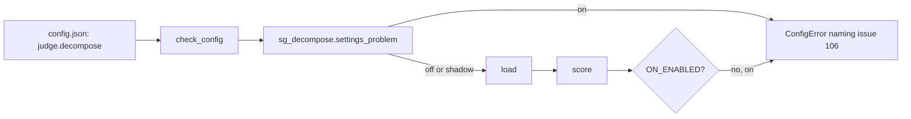

# Handoff: SGR-3

## What changed
`.story-gate/sg_decompose.py`: `ON_ENABLED = False`, `HARDENING_ISSUE = 106`, and `settings_problem` refuses `on` while the flag is false. `.story-gate/gate.py`: `score` raises `ConfigError` for `on` as a second guard. `.story-gate/sg_settings.py`: the settings text. Docs: the decision record (new section), guide, PROTOCOL.md, README. `.story-gate/release.json` and `.sig` removed, as RELEASING.md says for a pull request that changes runtime files. Tests in `tests/test_gate.py`.

## Interfaces and contracts
- `judge.decompose` accepts `off` and `shadow` only. `on` gives a `ConfigError`; nothing downgrades it.
- `TestDecompose.set_on_enabled(flag)` switches the flag in the test repository's own copy of `sg_decompose.py` and in the imported module.

## How to verify
Run `python3 -m unittest tests.test_gate.TestDecompose tests.test_gate.TestDecomposePure`.

## Known limits
`on` stays disabled until issue #106 is done: cross-AC test side effects in packs, a large file cut from a pack, and the request cap on changes with many files.

## Downstream consumers
Release 2 (the advisory written "why") and the hardening story for #106.

## Release and rollback
Ships with PR #99. Rollback: revert the commit that disables `on` only if `on` is meant to be enabled; otherwise set `judge.decompose` to `off`.

## Drift decisions
None.
