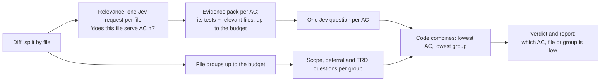

# The judge asks narrow questions over evidence packs (2026-10-22)

**Problem.** The judge sends one request with about ten broad questions per phase. At DONE it sees the diff cut to 45,000 characters (`judge.max_chars / 2`). On a real story (Viaknox/vkgate VKG-005: 8 acceptance criteria, about 65,000 characters of diff, 113 passing tests), "the diff implements every acceptance criterion" scored 0.21. With the whole diff visible it rose only to 0.32. The judge returns numbers only (Jev never writes text), so nobody could tell which criterion it doubted. An independent review, one criterion at a time, found three real bugs the judge never pointed to.

**Decision.** Two signed releases. A frontier panel chose this design 4 to 0.

- **Release 1 (this record): narrow questions.** Each broad check becomes several small Jev questions: one per acceptance criterion or per group of files. Each question gets only the evidence that relates to it: an *evidence pack*. Code combines the answers. The report names the criterion, file or group that scored low.
- **Release 2 (next): a written "why".** A check that still fails gets a 1-2 sentence advisory reason from a model of a different family from the coder. The reason can never change a score or a verdict. It has its own decision record.

**Rejected.** Sending the whole diff with the same broad questions: it did not fix the real failure. Replacing Jev with a general model that writes reasons: it loses calibrated scores and mixes text into the verdict. Scoring "the best chunk" for each criterion: a criterion implemented across several files would look unmet. That is why packs are chosen per criterion instead.

## How Release 1 works

- **Modes.** `judge.decompose` is `off`, `shadow` or `on`. The default in Release 1 is `shadow`: the old judge still decides, and the new scores are recorded next to it for comparison. The owner switches a repository to `on` after comparing. `off` behaves exactly like today.
- **DONE.** `impl_matches_acs` is the lowest of the per-AC scores, and `tests_implemented` is also scored per AC. `impl_no_unplanned_scope`, `no_deferrals` and `drift_trd_after` are scored per file group, and each is the lowest group. The drift direction comes from the group with the lowest TRD score. `handoff_out` and `learnings_specific` are asked once over the story records, and again per file group (does the handoff contradict or leave out what these files add; do the learnings miss a failure visible here). Each is the lowest answer. The broad judge's cut of the whole diff (over half of `max_chars`) does not cap the narrow scores: each pack and group carries its own truncation. The gate's own records in the story folder (story.md, tests.json, verdicts and the like) are left out of packs and groups, because the judge already gets the story. A project copy named `<ID>.md` stays out of the AC packs but stays in the file groups, so scope, deferral and drift still see it. The gate's diff already leaves out the whole `.story-gate/stories` tree for every check, as it did before this change. The record filter here is a second guard for a caller that passes a raw diff. If no group answered the drift question, drift is `architect_must_decide`, not `none`.
- **READY.** `ac_testable` and `tests_plan_adequate` are scored per AC, and each is the lowest AC. `dor_no_blockers` says what counts: follow-ups for after the merge, recorded decisions and dated known exceptions are not open questions.
- **Fail closed.** If evidence is cut (a pack or a file is over its budget), or the request cap is reached, that check cannot PASS. It shows CONCERNS at best, and its `why` names what was cut or not asked. A linked test longer than 200 lines, or a large file whose relevance was judged from its first part only, also counts as cut. Repeated or empty acceptance-criterion ids refuse to score, because packs and answers are keyed by id. An AC whose text is over 2,000 characters, and a binary change (only its header can be shown), also count as cut. A changed test hunk that names none of the test_refs (an edit below a test's definition) goes through relevance like code. So do a linked test file's other edits: a helper, fixture or import outside its linked tests, or an unlinked test in the same file. A pack shows only an AC's own test blocks, so without this a weakened helper could reach no question that checks the code.
- **Untrusted text stays out of the questions.** The question wording is fixed. The AC text sits only in the request state, which the judge treats as untrusted evidence. AC ids, the only story text in the wording, must be short plain names (letters, digits, `. _ : -`).
- **Weaker rule.** Changing `judge.decompose` from `on` to `shadow` or `off` is reported as a weaker policy, like other loosened settings.
- **Cost.** About 1 + files + ACs + groups requests per DONE score, a few cents at most, capped by `judge.max_requests` (default 60). Requests run 4 at a time.
- **Records.** `ready.json` and `done.json` gain a `decomposed` object: schema `decompose-1`, mode, per-item scores, the files in each pack, truncation flags, the model id and an evidence hash. Old readers ignore it. The judge schema and mode are part of the policy fingerprint, so a changed method re-scores instead of reusing an old verdict.
- **Rollback.** Set `judge.decompose` to `off`, or roll back the release with `gate.py rollback`.

## Done when (Release 1)

1. With `decompose: off`, every request, record and verdict is the same as before (the existing tests pass unchanged).
2. With `shadow`, the binding verdict is the old one, and `decomposed` holds the new scores plus a would-be overall.
3. With `on`, the new scores decide. For each failing check the report shows the lowest items with their scores, for example `AC3 0.21 (files: scripts/check.mjs, test/check.test.mjs)`.
4. An AC implemented across two files scores from one pack that holds both files. No per-chunk maximum is taken anywhere.
5. A pack or file over its budget, or the request cap, makes that check unable to PASS, and the report says why.
6. Each question's evidence holds only that question's pack, plus the story fields it needs.
7. Changing the mode, the judge schema or the judge model makes an earlier verdict stale.
8. Offline tests use a content-aware fake judge, including a fixture shaped like VKG-005 (8 ACs, about 65,000 characters of diff spread across files).
9. A live shadow run on 5 vkgate stories (VKG-005, 009, 001, 006, 007) records old and new scores side by side for the owner.
