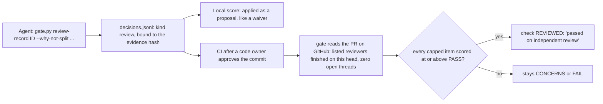

# A large change can pass on recorded independent review (2026-10-24)

**Problem.** Some changes are too big for the judge to read whole. The broad judge reads at most 45,000 characters of diff.
The evidence-pack judge (2026-10-22) splits a big change into file groups. It then caps scope, deferral and drift at
CONCERNS, because no question saw every file together. CONCERNS does not pass, and nobody can waive the structural
`evidence_complete` check. So a big change can never reach DONE, even after full independent review.

Measured on Viaknox/vkgate:
- VKG-001: about 110,000 characters of judged diff, split into 4 groups. Once its records were fixed, every narrow score
  was above the CONCERNS line, so only the size caps held it back.
- VKG-009: 740,000 characters, split into 21 groups. The judge reached its request cap, and most groups were never asked.

The `evidence_complete` message already says "split the story or get a human review of the whole diff". Until now
story-gate had no way to record that review.

**Decision.** A frontier panel voted 3 to 1 for this design. The owner chose to measure first, then build it.
- A code owner can record an independent review of the whole change.
- It lifts only the size caps, and only where the judge's own score on that item already passes.
- Reports call it **"passed on independent review: too large for one judge pass"**, never a judge PASS.
- A story the judge never scored (request cap, unreadable files) gets nothing from it. Split that story instead.

**Rejected.**
- Approval alone. Paul is not a coder, so "human review" would misdescribe what happened. The record must point to
  real independent review runs.
- Lifting caps where the narrow score is low. That would hide real findings.
- A general waiver of structural checks.

## How it works

- **Record.** `gate.py review-record <ID> --by <who> --why-not-split "<reason>"` appends one line to `decisions.jsonl`:
  `kind: "review"`, the phase (`done`), the reason, and the evidence hash. Like waivers and drift decisions it is bound
  to that hash. Any change to the code, story, tests, handoff, spec files or policy makes it stale.
- **Trust.** Locally it is applied as a proposal, like a waiver: the check shows `REVIEWED` with "proposal" in its
  reason, so the `done.json` committed with the work is right after the merge (dependants read it from the default
  branch). Even locally it lifts nothing under a policy CI could never accept (no reviewers, one reviewer, or no
  security reviewer), and the validation page labels it a proposal. CI always scores again. There it counts only when a code owner has approved the head commit (the same rule as
  waivers), and only after the live check below passes. The CI summary shows the review section only when that run
  scored DONE itself, never from the pull request's own copy.
- **Live check (CI only).** The gate reads the pull request through the GitHub API with the workflow token:
  - Every reviewer listed in `config.json` → `review_record.reviewers` has a finished review on the current head.
    At least two are required, and at least one must be marked `security: true`.
  - A reviewer is matched by its exact login; a `[bot]` login must also be a Bot account, so a person with a similar
    name never counts. Each reviewer's latest review of the head decides: `CHANGES_REQUESTED` or `DISMISSED` lifts
    nothing, even after an earlier pass. The pull request's author never counts as a reviewer.
  - Only a `codex-summary` reviewer may have a `part`, so one native login is always one reviewer.
  - The pull request has zero unresolved review threads.
  - The record lists the review IDs and the head it saw. If any part fails, the record lifts nothing, and the report
    says which part failed.
- **What it lifts.**
  - The structural `evidence_complete` CONCERNS ("too large for one judge pass").
  - In decompose `on` mode, the group cap on `impl_no_unplanned_scope`, `no_deferrals` and `drift_trd_after`. It lifts
    the cap only when every group's own score for that item is at or above the PASS threshold.
  - Nothing else. A check whose item scored below PASS, an item that was never asked, a cut file, or any FAIL stays as
    it was.
- **Status.** A lifted check has status `REVIEWED`. It counts like `WAIVED` for the overall verdict, for `passed()` and
  for dependants (`dependencies_done`). The overall verdict is `REVIEWED`. It shows apart from `PASS` everywhere: the
  check summary, the validation page and the dashboard.
- **Visibility.** The report lists the review IDs, the head SHA, the `why_not_split` reason, and a per-repo count of
  stories that passed on review. The count is a signal to split stories more, not a goal.
- **Weaker policy.** Removing a reviewer, dropping the security reviewer, or emptying `review_record.reviewers` is
  reported as a weaker policy, like other loosened settings. Adding a reviewer makes the rule stricter.
- **Codex.** Codex runs a code review and a security review under one login. When a round finds nothing, it posts no
  formal review: it only updates the machine-readable state in its summary comment. A reviewer entry with
  `"source": "codex-summary"` and `"part": "code_review"` or `"security_review"` reads that state. The state counts
  only from Codex's summary comment (it starts with `<!-- codex-pull-request-review-summary -->`), written by that login
  as a Bot, for the current head, with status `completed` and
  `has_unresolved_findings: false`. Two parts of one login count as two reviewers. The Codex login is matched exactly, so `codex` and `codex[bot]`
  are never two reviewers.

## Done when

1. Without a `review` record, every verdict is the same as before (existing tests pass unchanged).
2. A record made locally is applied as a proposal (marked "proposal"); CI scores again and decides.
3. In CI with a code owner's approval and a passing live check, `evidence_complete` and qualifying group caps become
   `REVIEWED`, and the overall verdict is `REVIEWED`.
4. It lifts nothing when any of these holds: a capped item scored below PASS; an item was not asked (request cap); a
   file was cut; a listed reviewer has no finished review on the head; a thread is open; no reviewer is marked security;
   the evidence hash changed; the head commit has no code owner's approval.
5. `dependencies_done` and `passed()` accept `REVIEWED`, like `WAIVED`.
6. Reports, the validation page and the CI summary say "passed on independent review" and list the review IDs.
7. Offline tests cover each case in point 4 with a fake GitHub API and a fake judge.
8. PROTOCOL.md and the guide explain when to use it: only after splitting was considered, and the reason is recorded.

## Known limit
- The check runs on pushes, pull request edits and labels, and on review submitted, edited or dismissed. New review
  threads arrive with a review, so they re-run it. Two changes do not re-run it: a person unresolving a thread, and a
  Codex re-review started on the same commit (its summary says "running" until it posts). GitHub Actions has no trigger
  for either, and an `issue_comment` trigger would run the gate, with its secrets, on every comment. The owner's merge
  rule (every review bot finished, every thread resolved) covers this gap until GitHub offers a trigger.

## Out of scope
- A cross-group judge question (Release 1.1). It stays on the roadmap. This record is the compensating control until it
  exists, not a reason never to build it.
- Changing the request cap. A story the judge couldn't ask about should be split.
