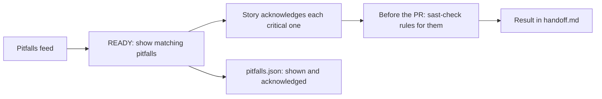

# Known pitfalls

Known pitfalls are mistakes that other projects kept making. A learner (a separate tool) finds them in past reviews and
publishes them as a feed. story-gate shows each story the pitfalls that fit it, before any code is written. It is off
by default, so nothing changes until you turn it on.

## What happens



1. **At READY**, story-gate reads the feed. It shows the pitfalls whose stack and domain both fit the story: the most
   serious first, at most 5, each with its checklist.
2. **The story acknowledges** each critical pitfall in `context.md`, under `## Known pitfalls`:
   ```
   ## Known pitfalls
   - lp-0042: tokens are compared with hmac.compare_digest, and a test covers a wrong token of the same length
   ```
   An acknowledgement needs a real explanation: at least 10 characters, and not `TODO`.
3. **Before the pull request**, `story-gate pitfalls <ID> --scan` runs the sast-check rules written for the pitfalls
   shown, if sast-check is on your computer. It writes the hits into `handoff.md`.
4. **story-gate records** which pitfalls each story was shown and which it acknowledged, in
   `.story-gate/stories/<ID>/pitfalls.json`. A later step can then measure whether the same mistakes come back.

## Turn it on

Add this to `.story-gate/config.json` in a pull request of its own:

```json
"pitfalls": {"mode": "warn", "source": "https://example.com/patterns-public.json"}
```

| Setting | Values | What it does |
|---|---|---|
| `mode` | `off` (default), `warn`, `enforce` | `warn`: shown, and a missing acknowledgement is a WARN that never blocks. `enforce`: READY fails until every critical pitfall shown is acknowledged |
| `source` | a file path or an `https://` URL | Where the feed is. A relative path starts at the repository's top folder |

Start with `warn`. Turning `enforce` off, or changing the feed in enforce mode, is reported as a weaker rule. Changing
the mode or the source makes stored READY verdicts out of date, so they are scored again.

## Tag each story

Each story names its stack and domain in the front matter of `story.md`:

```
stack: [python]
domain: [auth]
```

A pitfall fits when its stack and its domain both match. A pitfall with the stack `any` fits every stack (the same for
domain). A story with no `stack:` or no `domain:` can't be matched: READY says so (a WARN, or a failure in enforce
mode). Use `none` when nothing fits, for example `domain: none`.

## The feed

The feed is the learner's `patterns-public.json`, in this format:

```json
{"schema": "learner-patterns/v1",
 "patterns": [{"id": "lp-0042", "pattern": "...", "stack": "python", "domain": "auth", "cwe": "CWE-208",
               "hits": 14, "repos": 5, "impact_band": "critical", "summary": "...", "checklist": ["...", "..."]}]}
```

- `impact_band` sets the order: `critical`, `high`, `medium`, `low`. Then more `hits` and more `repos` come first.
- `stack` and `domain` are a word or a list of words. `checklist` is a list of lines (5 are shown at most).
- `repos` is a count of projects. The feed never names them.
- A feed in another format, or one story-gate can't read, is never a pass: READY shows a WARN, or fails in enforce
  mode. A pattern with no valid `lp-` id or no checklist is skipped, and READY says how many.
- Feed text is data from outside your repository. story-gate shortens each line to 300 characters, removes control
  characters, and shows it as advice to check, never as instructions. `pitfalls.json` keeps only ids and bands.

## Check for them before the pull request

```
story-gate pitfalls <ID>          # show the pitfalls for the story again (no judge, no cost)
story-gate pitfalls <ID> --scan   # run sast-check's rules for them on this change
```

`--scan` looks for sast-check in `SAST_CHECK_HOME`, then in `~/.claude/skills/sast-check`. It runs sast-check in diff
mode with its Opengrep rules, and keeps the findings of rules whose `metadata.learner_pattern_id` is one of the
pitfalls shown. sast-check's own settings, suppressions and fail-closed rules apply. The result goes into
`pitfalls.json` and into one section of `handoff.md`, which each scan replaces.

| Result | What the handoff says |
|---|---|
| sast-check ran | The rules run and each hit: pitfall, rule, file and line |
| No rule for these pitfalls yet | Nothing was scanned for them |
| sast-check isn't installed | No rule checked them |
| sast-check failed, or Opengrep isn't installed | The pitfalls are not checked. This is not a pass |

## In CI

CI reads the feed itself and never trusts `pitfalls.json`, which the pull request can edit. An `https://` feed is
fetched. A file in the repository is read from the base branch, never from the pull request. A feed on one computer
(for example `~/feeds/patterns-public.json`) can't be read in CI: in enforce mode READY then fails, so use a URL or a
file in the repository. CI then checks the acknowledgements in the pull request's `context.md`.

## Known limits

- The story chooses its own `stack:` and `domain:`. A story tagged with something unrelated, or `none`, matches no
  pitfall, and READY passes. CI shows the tags in its summary, so the person who approves the pull request can check
  that they fit the change.

- The scan runs on your computer, not in CI. Its result is reported, not checked.
- sast-check runs every Opengrep rule and story-gate keeps the matching ones, so a scan takes as long as a normal one.
